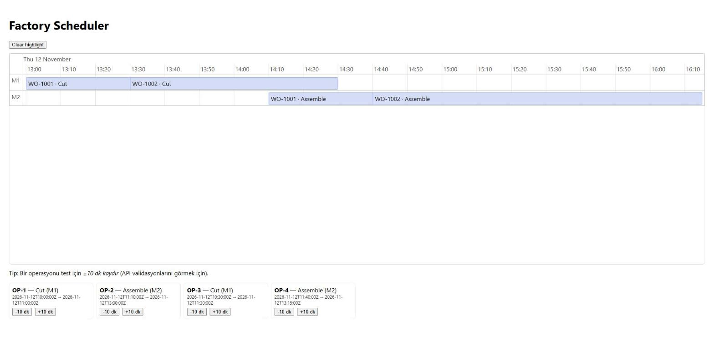

# Factory Scheduler – Fabrika Üretim Çizelgesi


> **English summary:** A small full-stack app (FastAPI + SQLAlchemy + PostgreSQL, React + vis-timeline) that shows factory work orders on a Gantt-style timeline and validates schedule changes with three business rules: operation precedence, machine-lane exclusivity and no scheduling in the past.

İş emirlerini ve operasyonlarını makine hatlarına (lane) göre Gantt benzeri bir zaman çizelgesinde gösteren ve operasyon zamanı değişikliklerini iş kurallarıyla doğrulayan web uygulaması.



## Özellikler
- **Zaman çizelgesi:** Her makine bir hat; çubuklarda `İşEmri · Operasyon` yazar, "şimdi" çizgisi görünür.
- **Vurgulama:** Bir operasyona tıklayınca aynı iş emrine ait tüm operasyonlar vurgulanır.
- **Güncelleme ve doğrulama:** Her operasyon kartındaki ±10 dk düğmeleri `PATCH /operations/{id}` çağırır; kurallar sunucuda uygulanır.
- **PostgreSQL** ile kalıcı veri; boş veritabanında örnek veri otomatik yüklenir.

## İş kuralları
| Kural | Anlamı | Hata kodu |
|---|---|---|
| **R1 – Öncelik** | Bir operasyon, aynı iş emrindeki önceki operasyon bitmeden başlayamaz; sonraki operasyon başlamadan sonra da bitemez | 409 |
| **R2 – Hat tekilliği** | Aynı makinedeki operasyonlar zamanda çakışamaz (uç uca değmek serbest) | 409 |
| **R3 – Geçmiş yasak** | Başlangıç "şimdi"den önce olamaz | 409 |
| Geçersiz aralık | Bitiş, başlangıçtan sonra olmalı | 422 |

Kurallar veritabanından bağımsız saf fonksiyonlardır (`backend/app/rules.py`) ve ayrıca birim testlerle doğrulanır. Başarısız bir güncelleme veriyi değiştirmez.

## Çalıştırma
```bash
docker compose up --build
```
- Arayüz: http://localhost:5173
- API: http://localhost:8000 (Swagger: `/docs`)
- PostgreSQL: `localhost:5432` (kullanıcı `app`, parola `app`, veritabanı `factory`; yalnızca yerel geliştirme içindir)

Örnek veri (`backend/app/seed.json`) her açılışta, **ilk operasyon bir sonraki tam saatte başlayacak şekilde ötelenir**; böylece demo her zaman gelecekte kalır ve R3 yüzünden güncellemeler baştan reddedilmez.

## API
| Yöntem | Yol | Açıklama |
|---|---|---|
| GET | `/health` | Sağlık kontrolü |
| GET | `/workorders` | İş emirleri; operasyonlar `index` sırasındadır |
| PATCH | `/operations/{id}` | `{ "start": "...", "end": "..." }` (ISO-8601) ile zaman günceller |

Örnek hata yanıtı:
```json
{ "detail": "R1 violation: Operation must start at or after previous operation ends (OP-1 ends 2026-11-12T11:00:00+00:00)." }
```

## Geliştirme ve test
```bash
# Arka uç (SQLite ile çalışan testler, PostgreSQL gerekmez)
cd backend
pip install -r requirements-dev.txt
python -m pytest            # 22 test

# Ön yüz
cd frontend
npm ci
VITE_API_BASE=http://localhost:8000 npm run dev
npm run build               # tip denetimi + üretim derlemesi
```
GitHub Actions her push ve pull request'te arka uç testlerini ve ön yüz derlemesini çalıştırır.

## Yapı
```
backend/app   main.py (API), rules.py (iş kuralları), crud.py, models.py, schemas.py, seed.py
backend/tests rules ve API testleri
frontend/src  App.tsx (zaman çizelgesi), api.ts (istemci)
```

## Bilinen sınırlar
Operasyonlar yalnızca ±10 dk düğmeleriyle kaydırılır (sürükle-bırak yok); kimlik doğrulama yoktur; tarih görüntüsü tarayıcının yerel saat dilimini kullanır, API UTC çalışır.